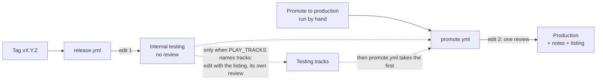

# Contributing

See [`AGENTS.md`](AGENTS.md) for how the code is laid out and checked.

## Building

The MilkDrop visuals build [projectM](https://github.com/projectM-visualizer/projectm) (LGPL 2.1) from the `third_party/projectm` submodule, so clone with submodules: [`AGENTS.md`](AGENTS.md#commands) has that and the build, test and check commands. Its presets in `app/src/main/assets/milkdrop/` come from projectM's [Cream of the Crop](https://github.com/projectM-visualizer/presets-cream-of-the-crop), [Milkdrop Original](https://github.com/projectM-visualizer/presets-milkdrop-original) and [En D](https://github.com/projectM-visualizer/presets-en-d) packs, and from Ryan Geiss's [favorite presets of January 2021](https://www.geisswerks.com/about_milkdrop.html), by their authors in each file name. 46 are Geiss's copies, with his own ratings, and 6 of those are in no projectM pack. The images some of them draw with, in `app/src/main/assets/milkdrop-textures/`, come from projectM's [Milkdrop Texture Pack](https://github.com/projectM-visualizer/presets-milkdrop-texture-pack). Gradle downloads the pinned NDK and CMake if they're missing.

The submodules stay untouched. Where projectM or whisper.cpp print a warning when built, [`app/src/main/cpp/patch.cmake`](app/src/main/cpp/patch.cmake) fixes a copy in the build folder, and stops the build if an update moved the text it replaces. Drop each fix once the submodule has it. The same edits are in [projectM PR 1076](https://github.com/projectM-visualizer/projectm/pull/1076) and [whisper.cpp PR 4167](https://github.com/ggml-org/whisper.cpp/pull/4167).

Every work by others the APK holds or downloads has a notice in [`notices.txt`](app/src/main/resources/com/astrovm/crosstune/notices/notices.txt), with its license's full text beside it. The app shows them in **Settings** → **About** → **Licenses**, and README's table matches them. Crosstune's own words in them, the fields each notice's `translate:` line names, are translated into each app language in `notices-TAG.txt` beside it; the licence texts stay as published. Each translated block's `from:` line names the English it was made from, and `NoticeWordsTest` says what is missing or out of date. Each text is copied byte for byte from where its work publishes it, at the version the app uses: [`scripts/notices.py`](scripts/notices.py) says how they are recorded, fetched and checked. `./gradlew :app:notices` (in `:app:ci`) builds the release native code and fails on anything in the release APK with no notice: each library and each licence file inside one, each file dependency, each submodule, each compiled source and header, the NDK's libraries, each bundled file and each download. A licence or origin line in a compiled file, like "Copyright" or "adapted from", needs a `covers: source PATH ~ WORDS` line naming that file and words in that line. It fails too on a `covers:` line that covers nothing.

The monthly JMdict job also copies the two EDRDG pages and records their hashes in `jmdict-notice-texts.txt`. Review that snapshot with the word lists. Release checks it against the committed hashes, since EDRDG publishes these pages without a version.

CI logs have no warnings: one that shows up is a bug to fix, never to hide. Gradle is the version in `gradle/wrapper/gradle-wrapper.properties`. Kover 0.9.11 still calls `Configuration.setVisible`, which Gradle 9.8 deprecated and Gradle 11 will remove. The fix is on Kover's main branch ([PR 838](https://github.com/Kotlin/kotlinx-kover/pull/838), [issue 836](https://github.com/Kotlin/kotlinx-kover/issues/836)) and not in a release. Its report tasks also call `Task.getAnt()`. That call is still on Kover's main branch, and it is the use Gradle 10 removes. Renovate does not hold Gradle back. The Kotlin and Java compilers stop on a warning, so a new one fails the build. `python3 scripts/ci-warnings/ci_warnings.py --branch main` counts what is left in the logs, per job and per kind; `--lines` lists them.

You need the Android SDK and JDK 17 or newer to build, and JDK 23 or newer to run the tests and detekt: their JVMs start with `--sun-misc-unsafe-memory-access=allow` (in `app/build.gradle.kts`), which JDK 23 added and JDK 22 refuses to start with. CI uses JDK 25. When building from the command line, set `sdk.dir=/path/to/Android/Sdk` in `local.properties`.

[`scripts/gradle-box/gradle-box.sh`](scripts/gradle-box/gradle-box.sh) runs any Gradle task in a container, with only the checkout, the SDK and the debug key in it, in turn with the other checkouts on the machine. It needs podman and python3. Its cache is in `GRADLE_BOX_DIR` when set, otherwise in `crosstune-gradle-box` under `XDG_CACHE_HOME` or `~/.cache`. Its header says how builds share the memory and the CPUs, when to ask for less with `GRADLE_BOX_MEMORY`, and how to set it up on a Mac and on Apple Silicon.

Every tracked Python file passes [ruff](https://docs.astral.sh/ruff/), with the rules in [`ruff.toml`](ruff.toml), each with what it catches beside it, and every tracked shell script passes [ShellCheck](https://www.shellcheck.net). The **python** job in CI runs both, `ruff check` with the version pinned in [`scripts/ruff-requirements.txt`](scripts/ruff-requirements.txt), which Renovate bumps. Run the same one here with `uv run --no-project --with-requirements scripts/ruff-requirements.txt ruff check`, or install that file in a venv. A finding is fixed, not silenced: no `# noqa`, no `per-file-ignores` and no `# shellcheck disable`. A rule that is wrong for these scripts leaves `select` in `ruff.toml` or goes in its `ignore`, with the reason beside it. `python3 scripts/unittests.py` runs the Python tests of every folder under `scripts/`, as CI does.

`:app:ci` runs the Robolectric tests with a 100% line and 88% branch coverage gate, lint, [detekt](https://detekt.dev)'s checks for tangled logic, and the debug and minified release builds. Reports go to `app/build/reports/`. CI runs the tests, lint and builds as parallel jobs, and skips them for pull requests that only change text and tools around the app, as `ci.yml`'s `changes` job lists them: the docs, the site, the store text, the report Worker, the extension, and the scripts that never reach the app. The scripts' own tests and the report Worker's run either way.

`MatcherCasesTest` holds the YouTube Music matcher to what `main` opens: the inputs its reviews tried, a matrix of about 83,000 searches and 4,000 made-up ones, each in 7 ways (signed out, as ChatGPT picks, and with the link's own length alone), against `main`'s answers in `app/src/test/resources/matcher-*-main.tsv.gz`. It runs one in 20 of the matrix and the made-up searches; `-PmatcherFull` runs all, as CI's **matcher** job ([`matcher.yml`](.github/workflows/matcher.yml)) does when a pull request changes the matcher or what it reads names and links with (the files are in `ci.yml`'s `changes` job), and the **Mutants weekly** workflow does each week. A change that changes what opens makes them again on its own code: set `onMain` in the test, run it with `-PmatcherSongs=KEY,...` in parts short enough, and put the parts' lines together in the matrix's order; or gzip the `matcher-*-now.tsv` files from the **matcher** job's artifact. Its PR shows the counts the test prints, before and after. PIT's runs skip the matrix and the made-up searches, so a few of them, one in 211, are held to what the branch itself opened, in `app/src/test/resources/matcher-snapshot.tsv.gz`: a change that changes what opens writes it again, with `writeSnapshot` set in the test, from `app/build/matcher-snapshot.tsv.gz`.

`python3 scripts/mutants.py` runs [PIT](https://pitest.org) mutation testing on the lines of code a branch changed from `origin/main`, uncommitted ones too, and lists every change no test caught. The PIT plugin in [`tools/pitest-changed-lines/`](tools/pitest-changed-lines) leaves out code no test can be said to run: Kotlin's own null checks, the code Compose adds and the bridges Kotlin adds. It takes minutes to an hour, depending on the change. It never blocks a merge: the **Mutants** workflow runs it on each pull request that changes the app's code, outside the required checks, and comments what lived.

`TitlesAgainstMainTest` reads 200,000 seeded random titles (`TitleFuzz.kt`) with each function that reads a song's title, and fails on any that reads worse than main did on a phone. The unit tests read one title in 20; `-PfuzzFull` reads all of them, as CI's `fuzz` job does. So do the other fuzzes that take most of a minute (`Fuzz.kt`). Main's readings are in `app/src/test/titlefuzz/main.tsv.gz`, made by [`scripts/titlefuzz/baseline.py`](scripts/titlefuzz/baseline.py) on the crosstune-phone emulator from a main checkout, so the test runs alone. A reading that differs and is better is listed in the test, with why; each difference goes to `app/build/titles-differences.tsv`. Make the file again when `TitleFuzz.kt` changes the titles, or when main's readings are to be the new floor.

On Android, `Regex` runs on ICU, which reads `\s`, `\w`, `\d`, `\b`, `.`, `$` and case otherwise than the JVM the tests run on. `phoneRegex` writes each of the app's patterns out for the JVM in what ICU reads, with the tests' writer, `IcuPattern.kt`, from `PhoneRegexTable.kt` and `PhoneRegexSets.kt`, which `python3 scripts/regextable/regextable.py probe` makes from the newest emulator. On a phone it's `Regex` itself, so the app holds neither the writer nor the sets only it reads. `PatternsOnThePhoneTest` holds every pattern to what it found on the emulator (`regextable.py patterns`, run on the newest Android and on Android 8, the oldest the app runs on). Each table has every pattern the app has and no other, and Android 8 finds what the newest finds, but where `ANDROID_8_READS_OTHERWISE` in the test says how the app handles it. Name a script as `\p{sc=Han}`, as Android 8 throws on `\p{IsHan}`. On the JVM the written-out patterns run two to three times slower.

`LongTitlesTest` reads titles made to be slow at 2,500 characters and at 10,000, with every reader, and fails on any that takes more than 4.5 times the work at four times the length: work in step with a title's length grows about 4 times, work squared 16. The work is counted, never timed, by the Java agent in [`tools/work-count`](tools/work-count/src/main/java/com/astrovm/crosstune/workcount/Agent.java), so it is the same on every machine and in each run, and noise can't fail it. Its Javadoc says what it counts, what it can't see, and what fails the test by name. It also charges each matcher reset and pattern change for the copy of the input that Android's regex engine makes, so a JVM matcher can't hide work that grows with the input on a phone. Work handed to another thread isn't counted, so a reading that leaves the other Java threads more than 1 ms of processor time fails by name (`Growth.BESIDE_NANOS`). Counting is many times slower, so it runs only in `:app:growthTests`, and on CI in its own `growth` job; `testDebugUnitTest` reads each title once, 10 times shorter, so Kover still counts what it runs, and judges nothing. `LongPagesTest`, J-Total's long sheets in `LongSheetsTest` and `LinearPatternsTest` do the same through `Growth.kt`, which writes each text's counts, growth and the processor time beside each reading, in µs, to `app/build/growth/TASK.tsv`, such as `growthTests.tsv`. On a phone each look with a pattern copies the whole title first, so time it there too: `python3 scripts/titlefuzz/baseline.py HEAD --long`. For Issue #991, its `--long-all`, `--long-warm` and `--long-matcher-input` measure the 300 ms phone target on the emulator; its header says how. CI judges work counts, never a time.

The app ships a [baseline profile](https://developer.android.com/topic/performance/baselineprofiles/overview) in `app/src/main/generated/baselineProfiles/`, so Android compiles the code used on startup and on the main screen ahead of time, also for installs from GitHub. Builds use the committed profile and never need a device. After big changes to the screens, regenerate it on an English emulator or phone with Android 9 or newer and commit the result. It runs on every connected device, so with more than one, pick one with `ANDROID_SERIAL` (see `adb devices`):

```bash
ANDROID_SERIAL=emulator-5554 ./gradlew :app:generateBaselineProfile
# Optional: compare cold starts without compilation and with the profile.
./gradlew :baselineprofile:connectedBenchmarkReleaseAndroidTest -Pandroid.testInstrumentationRunnerArguments.class=com.astrovm.crosstune.baselineprofile.StartupBenchmark
```

[`scripts/perf/perf.py`](scripts/perf/perf.py) measures how smooth the dev app is on a phone, the same way each time: janky frames while the main screen scrolls (`jank`), main-thread and app CPU on what is on screen (`cpu`), and cold starts (`start`). With `--build LABEL=APK` given twice, it installs the two builds in turns, so both get the same phone as it warms up. Measure a release-like build: `-PperfBuild :app:assemblePerf`. Two release-like builds need the same `versionCode`, as Android won't install an older one over a newer one, so build the version before with this one's number; it stops before any install when they differ. Its header has the commands and what it needs.

`-PcomposeReports` writes the Compose compiler's reports to `app/build/compose/`: the classes it can't call stable and the composables it can't skip. With the Kotlin built into the Android Gradle plugin, a change to the compiler's options doesn't make Kotlin compile again, so add `--rerun` to `:app:compileDebugKotlin`. `app/compose-stability.conf` lists the classes the app never changes once made, so Compose skips a screen handed an equal copy.

The version is set explicitly in `app/build.gradle.kts`: `versionName` is `X.Y.Z`, and `versionCode` is `X*1000000 + Y*10000 + Z*100`. Builds use these values even without Git history or tags.

## Releasing

1. Update `versionName` and `versionCode` in `app/build.gradle.kts`, and add the changelog under `fastlane/metadata/android/en-US/changelogs/<versionCode>.txt`, in the last pull request going into the release rather than one of their own. Merge it before releasing. CI and the Release workflow require a nonempty English changelog for the current version before building. Run `python3 scripts/release/check_changelog.py` to check it locally.
2. Push a tag with `git tag vX.Y.Z && git push origin vX.Y.Z`, or run **Actions → Release → Run workflow**.
3. The [Release workflow](.github/workflows/release.yml) runs the CI checks, verifies that the APK's version matches the tag, then signs and publishes `Crosstune-vX.Y.Z.apk`, and `Crosstune-vX.Y.Z.aab` for Google Play. Signing runs in the `release` environment, which only `main` and `v*` tags can use; add required reviewers to it under **Settings** → **Environments** to approve each release by hand.
4. Once `PLAY_SERVICE_ACCOUNT_JSON` is set, it sends the release to Google Play. The App Bundle and its English changelog go to internal testing first, which Google doesn't review, so testers there get it in minutes. That's all the release sends: Google reviews nothing yet. When the `PLAY_TRACKS` repository variable names testing tracks, one more edit sends the same release on to each of them, with the store listing in the languages of `PLAY_LANGUAGES`, and that edit goes to Google's review. Without the secret, download `Crosstune-vX.Y.Z.aab` from the GitHub release and upload it in Play Console. It's signed with the same key, which Play uses as the upload key.
5. Production is a step of its own: **Actions** → **Promote to production** → **Run workflow**, with the version (`2.26.0`). [`promote.yml`](.github/workflows/promote.yml) sends that release from internal testing on to production, with its English changelog and the store listing in the languages of `PLAY_LANGUAGES`, in one edit. Both come from the release's tag, so production gets the words and pictures of the version it ships, not main's as it is by then. So Google reviews each release once. When `PLAY_TRACKS` names testing tracks, it takes the release from the first of them instead, with only its changelog, as the listing went to review with them. Production never goes to review with a testing track. Before it sends anything it checks that the version's tag `vX.Y.Z` is on origin, that no version code on Play lacks a tag (the check the release job makes), and that the bundle Play has as that version code is the one the Release workflow made, by the SHA-256 in the release's notes. Any failure stops it with nothing sent.
6. The listing also has a workflow of its own, [`store-listing.yml`](.github/workflows/store-listing.yml), run by hand only: to send the listing between releases, from another branch, or in a language the store doesn't have yet (name its folders in **languages**). With **check_only** it only asks Play whether it would take the listing. Each run that isn't a check goes to Google's review.



Google Play cancels a review in progress when a new edit is committed, and every cancel puts the app at the back of the queue, so every commit these workflows make asks Play to keep the review. The three jobs run one at a time, as Play takes one edit at a time. GitHub keeps one job waiting: a newer one cancels it, so re-run that one. All three run [`.github/play/play.sh`](.github/play/play.sh). `play.sh --help` prints what each command sends, what it checks before it sends anything, and when it stops; [`play.rb`](.github/play/play.rb)'s header has each check. When a job stops on a version code that no tag on origin has, take it off in Play Console, or push its tag, then re-run the job. Releases are tagged on `main` only, so each one is newer than everything on Play. A tag with a suffix (`v2.27.0-rc.1`, or `v2.27.0.1`) is a test of the coming version without it, and has its version code: it makes a GitHub pre-release only, which is never the latest release and isn't sent to Play, and the app's update check counts it as older than that version. A release's notes start at the final release before it, never at its own test versions. The Release workflow writes the ``App Bundle SHA-256: `…` `` line that `promote.yml` checks next to the signing certificate's, from the signed App Bundle it keeps on the release, and publishes nothing when the file it downloads isn't the one the sign job hashed. The jobs check out only `.github/play/` and the store text, so none of the app's build code is where the Play key is, and `play.sh setup` installs Bundler and fastlane at the versions and checksums in its `Gemfile.lock` in a step before the key is there, as installing a gem runs its own code. CI runs `play.sh` against a fake Play (`.github/play/test/play_test.rb`), and `scripts/release/test_play_workflows.py` checks that the workflows reach Play only through it.

| Repository variable | Value |
| --- | --- |
| `PLAY_TRACKS` | Optional. Testing tracks each release goes to after internal testing, with commas between, such as `beta` for open testing. None when it isn't set or is empty, which is how releases go: internal testing, then production, with one review. Named, each release goes to review twice: once on those tracks with the listing, and once on production. It can't name `production` or `internal`, or a form factor's, such as `tv:production` |
| `PLAY_LANGUAGES` | The listing's languages each release sends, with production or with the testing tracks: folders of `fastlane/metadata/android`, with spaces between. `en-US` when it isn't set |

It needs these repository secrets:

| Secret | Value |
| --- | --- |
| `RELEASE_KEYSTORE_BASE64` | Output of `base64 -w0 release.keystore` |
| `RELEASE_KEYSTORE_PASSWORD` | Keystore password |
| `RELEASE_KEY_ALIAS` | Key alias |
| `RELEASE_KEY_PASSWORD` | Key password |
| `PLAY_SERVICE_ACCOUNT_JSON` | Optional. JSON key of a Google Cloud service account with release access to the app in Play Console. Without it, the Play jobs skip Play with a notice. The jobs hand it to `.github/play/play.sh` as `PLAY_KEY_JSON`. |

> Back up the keystore and never replace it. Android only installs an update if it's signed with the same key.

The release APK is reproducible: building the same tag elsewhere gives the same APK, apart from the signature. That's what F-Droid needs to ship it, if it's ever listed there. Google Play installs update GitHub ones only if Play App Signing uses this same key. To check a release locally, build the tag from a fresh clone and run `apksigcopier compare Crosstune-vX.Y.Z.apk --unsigned app/build/outputs/apk/release/app-release-unsigned.apk`. The APK uses v2 and v3 signatures. The verification job installs apksigcopier from wheels with recorded SHA-256 hashes.

Store listing text lives in [`fastlane/metadata/android`](fastlane/metadata/android).

The website at [crosstune.cc](https://crosstune.cc) is built from [`site/`](site): templates plus one strings file per language. After changing it, run `python3 scripts/build-site.py` and commit `docs/` too. The **Pages** workflow publishes `docs/` when it changes on main, then has Cloudflare check its cached copies against the new files. Pages publishes from Actions: **Settings** → **Pages** → **Source** → **GitHub Actions**.

## Chord sheet widths

Chords from J-Total sit over the letter they sit over on J-Total's page, as a Japanese reader's browser on Windows draws it. Some letters are not whole columns there: ۰ is 1.144 columns on the main font stack and 1.200 on the monospace one. `ChordSheets` uses the widths in [`jtotal-widths.txt`](app/src/main/resources/com/astrovm/crosstune/jtotal-widths.txt) and [`jtotal-widths-mono.txt`](app/src/main/resources/com/astrovm/crosstune/jtotal-widths-mono.txt), one for each stack.

Both tables come from Windows. The workflow [`jtotal-widths-windows.yml`](.github/workflows/jtotal-widths-windows.yml) measures them on GitHub's `windows-latest` runner, in Chromium in Japanese, with Windows' own fonts. Run it with `gh workflow run jtotal-widths-windows.yml`, download its artifact, and run `python3 scripts/jtotal-widths/jtotal_widths.py generate DIR` on it. `check DIR` says whether the tables are what DIR measured. Each table's header names the run, the browser and the font versions. The header of [`jtotal_widths.py`](scripts/jtotal-widths/jtotal_widths.py) says what the run measures and what it doesn't (Issue #976), and how its `container` and [`contexts.py`](scripts/jtotal-widths/contexts.py) compare other machines.

Not measured: a real Japanese desktop's own settings (the runner is a server image with the Japanese fonts added), Firefox, and macOS, which draws a different page as the stack's Hiragino name is not a macOS font name (Issue #976).

[`compare_sheets.py`](scripts/jtotal-widths/compare_sheets.py) measures how well that works on crawled sheets: a browser draws each page, and the script says which chords the app puts over another letter than the page does. The Windows workflow fetches the sheets in [`sheets.txt`](scripts/jtotal-widths/sheets.txt) and draws them in Japanese. Its artifact keeps no words and no chord names, only where each chord is and a hash of each line, and GitHub deletes it after a day. The crawled pages are other people's work: they go in the agent cache, never in Git. Its header has the commands.

## Japanese readings

[`jmdict-readings.txt`](app/src/main/resources/com/astrovm/crosstune/jmdict-readings.txt) lists words of two or more kanji and words with one kanji followed by る or るる that [JMdict](https://www.edrdg.org/dokuwiki/doku.php?id=wiki_index.php_jmdict-edict_dictionary_project) reads one way only, where IPADIC or UniDic read them another way: 体中 is からだじゅう, not からだちゅう. `Readings` reads a run of whole words as the file says. For a single-kanji る form, it uses the file only when the phone dictionary has no reading. JMdict is by the Electronic Dictionary Research and Development Group, under [CC BY-SA 4.0](https://creativecommons.org/licenses/by-sa/4.0/); the file's header says so, with JMdict's and the licenses' links, how the words were changed, the JMdict date and the [jmdict-simplified](https://github.com/scriptin/jmdict-simplified) version. A new file made from JMdict gets a `covers:` line in JMdict's notice.

Remake it with `python3 scripts/readingsaudit/readingsaudit.py table`, with `jmdict.json` (jmdict-eng) in the audit folder; `fetch` puts the newest one there. It runs `JmdictReadings` in the build box, which keeps a word only where the app reads it otherwise. Then measure the change with the same script's `run` and `compare --before`, on a copy of the audit from before; its top has the commands.

The Group's licence asks for its data to be updated regularly from the newest version. The [JMdict workflow](.github/workflows/jmdict.yml) does that on the 3rd of each month: it remakes both lists and opens one pull request from `jmdict/remake`, or updates the open one. Its top says how it fetches JMdict, when it stops, and how [`propose.sh`](scripts/readingsaudit/propose.sh) pushes the branch. Run it by hand with **Actions** → **JMdict** → **Run workflow**, optionally with a release tag. GitHub holds the runs of a pull request that a workflow opened or pushed: CI runs on it after a person with write access selects **Approve workflows to run** in its merge box, and the pull request's body says so. The workflow opens its pull request only when **Settings** → **Actions** → **General** → **Workflow permissions** → **Allow GitHub Actions to create and approve pull requests** is on. When it's off, the run pushes `jmdict/remake`, then fails and names that setting. The Release workflow fails when a file's JMdict is more than 90 days old (`readingsaudit.py age`): three monthly runs missed or left unmerged. A readings test that fails on that pull request means JMdict now reads a word another way: find out which reading is right, and fix the reading or the list, not the test.

A reading that is already right stays right. [`readings-golden.tsv`](app/src/test/resources/com/astrovm/crosstune/readings-golden.tsv) locks every word the audit finds read as it is sung, with IPADIC, UniDic or both: its kana and the parts they go over, and, on the row's stretch, the word sheet's romaji and the parts shown once the song's words put its reading right. Each row holds a bit of its line, with 3 more letters on each side, so a new rule that reads a word by the text right next to it fails a row too. `ReadingsGoldenTest` reads every row back with the app. A rule that looks further along the line, or at how long it is, gets past the rows, and some layers have no row at all: those are for the second lock, `readingsaudit.py lines`, below. The header of [`golden.py`](scripts/readingsaudit/golden.py) says what a row holds and where the rows stop, and `readingsaudit.py hole` measures the lock on the audit. What each lock caught and missed on the reviews of PR #931 is in Issue #959.

A fix that makes a word read right adds its row. After `run`, with the same audit folder:

```bash
python3 scripts/readingsaudit/readingsaudit.py golden
```

It runs `GoldenContexts` in the build box, which finds each stretch. The command adds rows. It does not remove or change one. When a locked word now reads otherwise, it names the word and exits with an error, and so does a right reading it can't lock. A change you mean drops that lock, for that word and kana only:

```bash
python3 scripts/readingsaudit/readingsaudit.py golden --accept WORD KANA
```

Before merging a pull request that changes how readings are made, merge main into it first, then read every line of the audit whole with main's code and with the pull request's:

```bash
git fetch origin main
git merge origin/main
python3 scripts/readingsaudit/readingsaudit.py lines
```

Run `lines` only on a branch you trust: it runs the branch's own scripts and build on your machine, with the audit folder mounted (Issue #956).

It reads every line of the audit whole, as the app shows it, with main's code and with yours, in one build box run, and fails on each reading main's code gets right that the pull request's shows otherwise, naming its layer, word, kana, dictionary and line. It refuses to run when your branch doesn't hold `origin/main`: merge main first. A change you mean: `--accept WORD KANA` for a reading, and the lines it prints for the body. `--accept-romaji` lets the romaji of lines read right change. It prints no line for the body, as CI reads no mark for romaji: say why in the body, for the reader. The layers and how it runs are in the header of [`wholelines.py`](scripts/readingsaudit/wholelines.py).

The golden file's header records the audit `lines` was last run on: `# audit: N lines, R right readings, sha256 H`. `lines` fails when the audit folder doesn't match it, so an empty, partial or other audit folder can't pass: get the audit back. A new audit is a lock change, as it changes what every later `lines` reads. Make one on purpose with `golden` on it, then `lines --new-audit`: it prints how many lines the named audit and the new one have, and how many go, then writes the new line. The pull request then needs a line `golden: new audit` in its body. When the number of right readings changes, `lines` writes the new header and fails: commit it, then run `lines` again. With no change, it prints `golden: lines checked DIGEST`. The digest names the readings sources and the Kuromoji lines on main and on the pull request, so after a new commit to either, the lint step asks for the command again. The songs' lines never go in Git, so CI can't run it. That line in the body is the author's word that they ran it and it passed; CI never prints it.

The lint job holds a pull request to the same rules. A pull request that removes or changes a row needs a line `golden: accept WORD KANA` in its body for each, where KANA is the kana the locked row has, the reading that goes, not the new one: the step prints each row it misses as the word, that kana, the dictionary and the stretch. A row that one dictionary read right and now both do (`ipadic` or `unidic` to `both`) is kept; one that goes the other way is changed. One that changes how readings are made (`Readings.kt`, `SmallKanaTokenizer.kt`, `SungReadings.kt`, `PageParts.kt`, `Furigana.kt`, `UniDic.kt`, `PhoneRegex.kt`, `PhoneRegexTable.kt`, `Patterns.kt`, `SongNames.kt`, the test side's `IcuPattern.kt`, `PhoneRegexSets.kt` and `TestUniDic.kt`, `jmdict-readings.txt`, `old-kana.txt`, `shifted-words.txt`, `common-split-words.txt` or the Kuromoji version, in `app/build.gradle.kts` or in `gradle/libs.versions.toml` if the build moves it there) has to change the file's rows too, or say `golden: none` on a line of its body when no reading changes; a comment or the order of the rows is no change. It also needs the `golden: lines checked` line that `lines` prints for it. CI can't check that line: it is the author's word that they ran `lines` on these commits and it passed. The step never prints the line to copy. So a Renovate pull request that bumps Kuromoji, and the JMdict workflow's, fail this step until a person runs `golden` and `lines` and adds their lines, as a new dictionary can read words otherwise. A pull request that changes the lock itself (`check_golden.py`, `golden.py`, `wholelines.py`, `source_calls.py`, `SourceTree.java`, `test_golden.py`, `test_source_calls.py`, `scripts/kotlinc/kotlinc.py`, `kotlinc.lock`, `GoldenReadings.kt`, `ReadingsGoldenTest.kt`, `GoldenContexts.kt`, `WholeLines.kt`) or moves or deletes the golden file needs a line `golden: lock changed`. `test_golden.py` keeps that list of reading files whole: `source_calls.py` follows each file the four golden harnesses reach, through calls, imports and members, as the Kotlin compiler parses them (`SourceTree.java`). It fails when a harness reaches a file the list misses, when the list names a file no harness reaches, and on reflection it can't follow. It needs a JDK 17 or newer, and the compiler's jars that `python3 scripts/kotlinc/kotlinc.py fetch` takes from Gradle's caches, or from Maven Central, each checked against `kotlinc.lock`. One that changes the golden file's `# audit:` line needs a line `golden: new audit`: the step prints the old and new line, and how many audit lines go. Only the right readings on that line may change without it, with a readings change, as `lines` writes them. The step copies `scripts/readingsaudit` out of main's commit with `git archive` and runs that copy, so no file of the pull request runs in it: changing the checker or the code it imports can't loosen it. Only the pull request that adds the checker, when main has none, is checked by its own. The step fails a pull request into any branch but `main`, as `HEAD^1` is then that branch, not main. The Kuromoji lines are compared in Python, not with `git diff`, so a `.gitattributes` that calls the build file binary can't hide a bump. The lock is there to catch accidents: a change that breaks a right reading and nobody sees it. It does not try to stop an author who works to get past it, for example by changing `ci.yml` itself: Issue #956 lists what stays open. The job reads the body when it runs: after an edit, run it again.

[`old-kana.txt`](app/src/main/resources/com/astrovm/crosstune/old-kana.txt) helps `Readings` read old kana in kana alone, which IPADIC splits: おもひで is おもいで. It lists JMdict's common words in kana with い, う or お after their first kana, each with the form it's looked up by, and the words in kana written with ひ, ふ or ほ today, おひる or くふう, where those kana are modern. It also lists common words with small kana and words JMdict usually writes in kana as な adjectives, with their written forms, for the tokenizer's search. These lists are separate from the old-kana words. It's from JMdict as well, under the same license, and its header says so. Remake it with `python3 scripts/readingsaudit/readingsaudit.py oldkana`, with `jmdict.json` in the audit folder. The same command makes `shifted-words.txt`, used to recognize shifted speech: the common nouns and pronouns in -ae, おまえ said おめえ, and the colloquial and slang い adjectives JMdict writes in kana, which IPADIC can lack, うざい said うぜえ. It also makes `common-split-words.txt`, the common verb forms used to preserve real word boundaries. Measure a change to old kana with `OldKanaNotes`, which lists every line that gets an old spelling note, with and without UniDic: `./gradlew :app:songCheck -PsongcheckTest=com.astrovm.crosstune.songcheck.OldKanaNotes -PsongcheckDir=FOLDER`, with the audit folder as `FOLDER` so its songs in `found/` count too. Then `diff` its `oldkana/` against a run from before. A note on a modern line is a false note. The [Agency for Cultural Affairs' spelling table](https://www.bunka.go.jp/kokugo_nihongo/sisaku/joho/joho/kijun/naikaku/gendaikana/huhyo_i.html) gives the corresponding modern kana.

## Practice clock evidence

The dev app can record Practice's native playback evidence under the `CrosstuneClock` log tag. It is off by default. A build without Android's debuggable flag ignores the tag even when its level is DEBUG. These records go only to logcat. They do not enter `TimingLog`, song reports, or automatic reports. They contain app package names, process-local session and attempt numbers, positions, times, speeds and capability flags. They contain no song names, artists, media IDs, URLs, metadata, extras or session tokens. Keep the captures out of git. [`scripts/clockcheck/README.md`](scripts/clockcheck/README.md#native-playback-evidence) says how to turn the tag on, capture it, and read each record.

Issue #929 needs the warm preview-end repeat, a line near that end on both card sides, an unanswered seek, and a stop-short after a session returns. Compare each with a delayed successful seek before changing any timeout or giving up sooner. Issue #939 needs 50 cards in each named music app and confirmation that the rare report sequences still play the line. Issue #984 also needs Spotify's real seek flag during an ad and a Connect session. A successful made-up media session does not satisfy those real-app checks.

## Reports

**Report a problem** and **Report song problems automatically** send to a Cloudflare Worker in [`report/`](report), at `report.crosstune.cc`. It keeps reports in the D1 database `crosstune-reports` (table in `schema.sql`), and a daily cron deletes those older than 180 days. D1's Time Travel keeps deleted rows up to 30 days more and can't be turned off, so the privacy text says so. It takes them only as JSON, at most 5 a minute from one address. Each kind of report has its own limits for one network in a day, for everyone in a day, and in the table, so a flood of one kind leaves the others their room and the database can't be filled; networks are counted under a key made with the secret `NETWORK_KEY`, and without it the Worker keeps nothing and answers 503. The numbers, and why they are what they are, are in the comments of [`worker.js`](report/worker.js) and [`sender.js`](report/sender.js), and in PR #955. A refused report says why in the `X-Crosstune-Refused` header, which the app doesn't read: it reads the status. So "not now" is always 429 or 503, and a report that is never taken is 400, 413 or 415; a test holds both. Each new report carries a random UUID, so one sent again is answered 204 and kept once. A manual song or wrong-reading report reuses its ID and payload on an unchanged retry. Editing it or reopening the dialog makes a new ID. Manual reports have no persistent queue. Older queued automatic reports can still have no ID.

Before deploying a Worker that uses a new table, column or limit, run on the live database what it needs, as each file's top says: [`limits.sql`](report/limits.sql), the `ALTER TABLE`s in `schema.sql`, and the migrations in [`migrations/`](report/migrations), each followed by `limits.sql` again. When you edit reports by hand, never use `REPLACE`, which deletes a row without its trigger, and run `limits.sql` again after any edit the triggers don't see. Test it with `node --test report/*.test.mjs`, and deploy with `npx wrangler deploy` from that folder (`cf deploy` finds no dev server there and stops).

Versions of the app from before crosstune.cc send to `report.crosstune.4st.li`. That address is a second Worker, [`forward.js`](report/forward.js), in the account that holds 4st.li: it counts a report against its sender's address and passes it on to the main Worker, with the secret `FORWARD_KEY` that says it was counted. Deploy it with `npx wrangler deploy -c forward.wrangler.jsonc`. When what it passes on changes, deploy it before the main Worker.

[`scripts/reports/reports.py`](scripts/reports/reports.py) goes through them: it reads the table, only ever reads it, into `build/`, shows the reports turned away each day and why, groups the reports by problem, version and song, and runs their songs through the app's real finders with `SongCheck`. Its top says how. They're people's songs, so they stay out of the repo, which is public. A pull request that only changes this script skips the app's CI jobs too, and its tests run either way.

## Browser extension

[`extension/`](extension) opens a music link in the service picked in its options, and shows the lyrics of what's playing on a music site in a side panel (Firefox's sidebar), in Chrome, Edge, Brave and Firefox. TypeScript, esbuild and no framework; it needs Node 24 or newer. [`extension/README.md`](extension/README.md) says how to build, test and load it, which tests run by hand, and how a new version goes out.

## Other tools

- [`scripts/device-check-build.sh`](scripts/device-check-build.sh) builds the dev app and one instrumentation runner for a check on a phone, into `build/NAME/`. The checks that use it say how: [chords offline](scripts/chordcheck/README.md), [the practice clock](scripts/clockcheck/README.md), [cover art](scripts/covercheck/README.md), [ChordWiki in a browser](scripts/wikicheck/README.md) and [playback without an artist](scripts/playcheck/README.md). The capture check, `CaptureCheck.kt`, says how it's built and run, with `--dirty`, since it's a probe often built with a fix not yet committed. [Song names on a recording](scripts/namescheck/README.md) builds main too, with `--at`: another commit, in a checkout of its own, with this checkout's runner put in.
- [`scripts/main-golden.sh`](scripts/main-golden.sh) writes what main's `SongNames` and `MediaSessionPlayback` did, for `NamesGoldenTest` and `PlayGoldenTest`.
- [`scripts/lib/adbtool.py`](scripts/lib/adbtool.py) finds adb on Linux and on a Mac, and the Samsung test phone, for the scripts that use a device.
- [`scripts/tv-banner.py`](scripts/tv-banner.py) redraws the TV launcher banner, `tv_banner.xml`, from the launcher logo and a Roboto font file.

## Screenshots and clips

The store's screenshots and the site's clips, in every language, come from [`scripts/shots/shots.py`](scripts/shots/shots.py), with no phone or emulator:

```bash
python3 scripts/shots/shots.py          # every language, both themes; its header has the options
python3 scripts/shots/banner.py         # then the banner, from the new English dark stills
```

It runs the `:app:shots` Gradle task, which draws the app's real screens with Robolectric on a clock that moves one frame at a time, so every run gives the same pictures, and copies both themes’ clips into `docs/img/`. Dark store screenshots go into `fastlane/metadata/android/`. The light ones are drawn too, as a check that the light theme renders, but not kept. The site selects clips and stills for its current theme, including system theme changes and reduced motion. The MilkDrop visuals behind the lyrics are drawn ahead with `render.py`, below, from a made-up beat. The scenes live in [`Shots.kt`](app/src/test/java/com/astrovm/crosstune/shots/Shots.kt).

## Recording the app

Screen recordings for promos come out steadier with [`scripts/record`](scripts/record) than with `adb screenrecord`, which drops frames. They run on `crosstune-phone` ([`scripts/emulator`](scripts/emulator/README.md)) and need no root:

```bash
python3 scripts/emulator/emulator.py start crosstune-phone
scripts/record/emulator.sh setup es-AR 01:46   # dark, clean status bar, clock and language
scripts/record/record.sh playlist.mp4 sh -c 'adb shell input tap 400 1005; sleep 7'
scripts/record/emulator.sh restore
```

`record.sh` records with [scrcpy](https://github.com/Genymobile/scrcpy) while Android's animations run at half speed, and plays the take back at double speed, so each of its 60 frames a second is a real one. Drive it at half speed too: double the waits and swipe durations.

Several agents share the test emulators and the Samsung phone. Hold the device with [`scripts/devicelock.py`](scripts/devicelock.py) for about as long as the job, instead of locking the file by hand: its header says how to take, release and share it.

[`scripts/milkdrop-render/render.py`](scripts/milkdrop-render/render.py) draws the MilkDrop visuals for any song into a 60 fps video, with the app's projectM, presets and settings, on a clock that moves one frame per frame, so slow renders still keep time with the song. [`scripts/contrast/contrast.py`](scripts/contrast/contrast.py) measures how readable the lyrics are over the visuals, from real screenshots on a phone, for each kind of text. Their headers have the commands and what they need.

Added or removed a preset? Run [`textures.py`](scripts/milkdrop-render/textures.py), which copies the images the presets draw with from a checkout of the texture pack and names those it lacks, then [`thumbs.py`](scripts/milkdrop-render/thumbs.py), which redraws the stills **Settings** → **Visuals** shows. Also list each new one under its kind in [`milkdrop-kinds.txt`](app/src/main/assets/milkdrop-kinds.txt): the folder it's in in projectM's Cream of the Crop pack, or `classics`.

To see how fast each visual draws on a phone, turn on the debug mode, then open the visuals. Each one draws as fast as it can for 1.5 s, and the log says its frames a second, by preset name, then all of them, slowest first:

```bash
adb shell setprop debug.crosstune.visuals_bench 1
adb logcat -s CrosstuneVisuals
```

A visual slower than 40 frames a second on a phone is skipped there from then on, as it makes the words over it stutter.

When a still image comes right before a video in an edit, use a frame of that video instead: browsers, and tools built on them, draw video a little lighter than images, so the screen jumps in brightness.