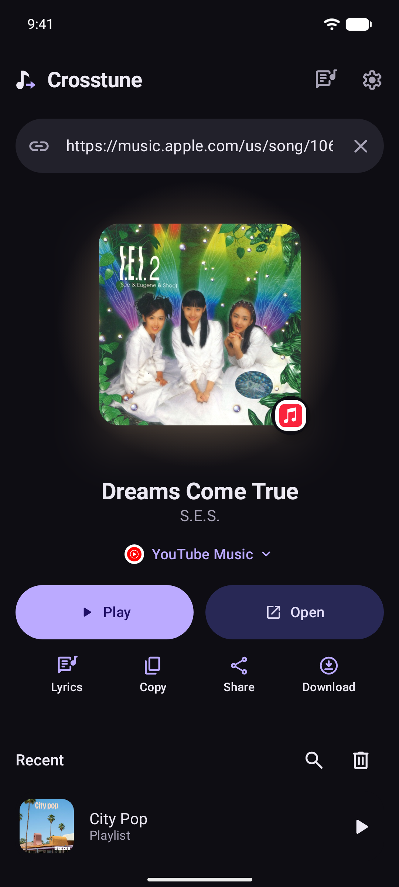
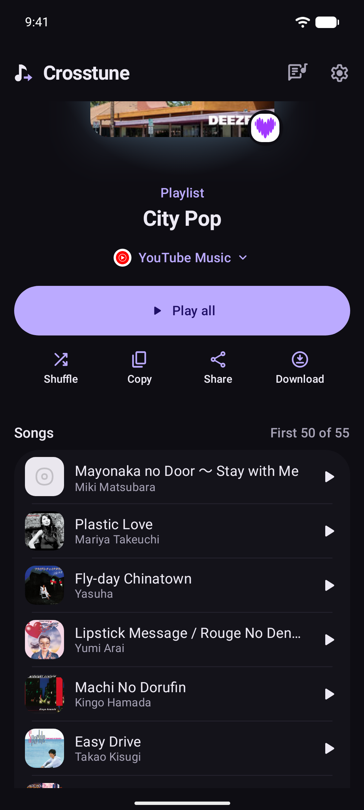
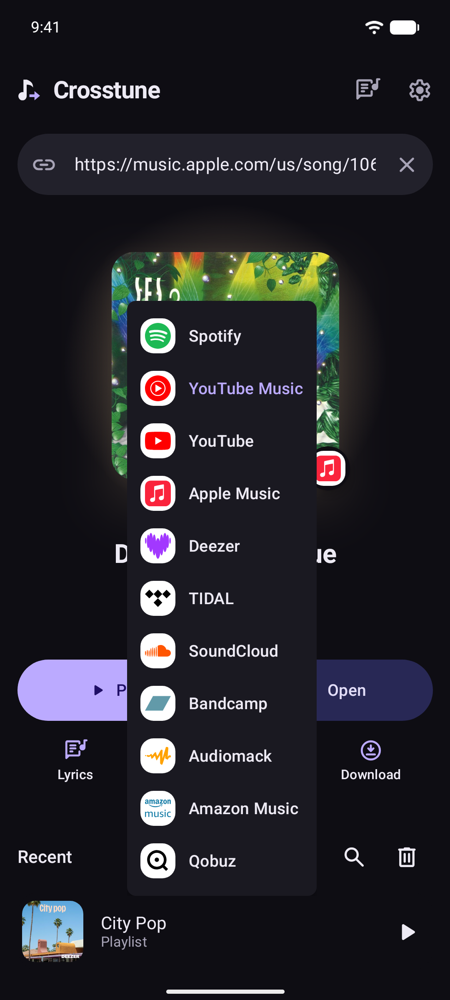

# Crosstune

Open a link from any service in the app you listen on, name the song playing nearby, and follow its lyrics and chords. Learn the words, and practice them with the music.

<p align="center">
  
  
  
</p>

## ⬇️ Install

Needs Android 8.0 or newer.

- Get the APK from [Releases](https://github.com/astrovm/crosstune/releases), or add `https://github.com/astrovm/crosstune` to [Obtainium](https://github.com/ImranR98/Obtainium) for updates.
- Or on Google Play, which is in testing: join the [testers group](https://groups.google.com/g/crosstune-testers), tap **Become a tester** on the [testing page](https://play.google.com/apps/testing/com.astrovm.crosstune), then install from [Google Play](https://play.google.com/store/apps/details?id=com.astrovm.crosstune).

## 🚀 Set up

Pasting or sharing a link to Crosstune works with no setup. Crosstune opens on its main screen, and under the link field lists what Android has to allow, each with what it gets you:

1. **Allow links in Crosstune**, so music links you tap in any app open here.
2. **Let lyrics follow your music**, so the words of what's playing show in time.
3. Tap one to see its steps: Android's page for your phone, a small guide floats over it, and it checks itself off once done. With [Shizuku](https://shizuku.rikka.app) or root on Android 12 or newer, tap **Fix all** instead. It's one tap.

Links from Spotify, YouTube Music, Apple Music, Deezer and TIDAL open here from the start. Turn on YouTube in **Settings** → **Open links from**. SoundCloud, Bandcamp, Audiomack, Invidious and Piped links open here when shared or pasted.

With one music app on your phone, songs play there. With more, the first one you pick on a song is where they play from then on. Change it in **Settings**.

Once you've opened something, anything left or broken later shows as **Things to fix** at the bottom of the main screen: **Fix all** with Shizuku or root, or **Fix one by one**.

## Features

- **Tap and go.** A link from one service opens in another, at the exact song, album or artist when the app supports it: Spotify to YouTube Music, Apple Music to Deezer, TIDAL to Apple Music.
- **Choose where.** Pick your music app once. Links go straight to it, or show in Crosstune first, with the song playing in that app. Set one app per service. YouTube and YouTube Music patched by ReVanced, RVX, Morphe or Vanced count as apps of their own, next to the official ones. Or add any app or site with a search URL like `https://example.com/search?q={query}`.
- **Not in the app you picked?** Crosstune says so, then opens the song where it's from or searches anyway. Choose in **Settings** → **When a song isn't found**.
- **Playlists and albums.** See their songs and open any one, or play the lot, in order or shuffled, in YouTube Music, YouTube, TIDAL or Spotify. With the phone locked, Spotify waits paused at each song's end until it's unlocked; on a phone with no PIN, pattern or password, **Wake for Spotify's next song** in **Settings** → **Advanced** turns the screen on at each song's end so it plays on. It stays on until it times out, as Android counts it as using the phone.
- **Recent.** Search your recent songs, and swipe one away to remove it. Its play button goes where links do.
- **Play and stay.** **Play** a song in your music app while you stay in Crosstune, with its own player: cover, progress, pause, skip, shuffle, repeat, seek and the app's own like. Swipe the cover to skip, play anything from what's up next, or set a sleep timer. The line being sung shows at the bottom, and the title opens the song's links. Whatever is playing waits in a bar on the home screen. Swipe up for the player, up again for the words, and down to go back. An app that only plays in front, like YouTube Music without Premium, plays under Crosstune's full screen, once Crosstune may show over other apps.
- **Name that song.** Crosstune listens for up to 12 seconds and shows the song playing nearby, like a pasted link. Or type a song's name to find it. If Shazam can't be reached, it opens the Shazam app or Google's song search instead, when you have them.
- **Lyrics in time.** The words follow your music app, even one on your computer that KDE Connect shows on the phone, or Crosstune listens along, song after song. Each line lights a moment before it's sung, so you've read it by then: set how early, and how far ahead the next line brightens (only its first word, when the words light one by one), in **Settings** → **Lyrics**. Tap a line to jump there, make the words bigger or smaller or center them, and fix the timing by tapping the line you hear or nudging it half a second at a time. Lyrics timed for another take offer the fix themselves. A cover with no lyrics of its own shows the original's, when its title says it's a cover or Apple credits the same songwriters. Also works with YouTube and YouTube Music patched by ReVanced, RVX or Morphe.
- **Chords.** Chord sheets over the words, with the capo, lined up letter by letter.
- **Offline.** **Download** on a song's, album's or playlist's card keeps it for offline: its lyrics, translation, chords and cover come over Wi-Fi and stay, up to the space set in **Settings** → **Advanced**. Each of its songs is also liked in your music app the first time it plays with Crosstune open, so the app downloads it too once it's set to download what you like: in Spotify, by downloading **Liked Songs**. Only apps that show whether a song's liked get it, Spotify, YouTube Music and TIDAL, so a song's never unliked; **Download in your music app too** turns it off. Offline, an icon says so, and a link waits until you're back online.
- **Recording timing.** Lyrics and corrections stay with their recording. With microphone access already allowed, lyrics briefly listen when a video, or a release longer or shorter than the one they're timed for, plays: they find how far ahead or behind it is and remember it after three agreeing audio fingerprints. Played once as the release they're timed for, they also learn how far Shazam's place in the song is from theirs, so another release Shazam matches the same way lines up too. They hear the phone's own sound, through headphones too, and the microphone only when the phone won't share it. With Shizuku or root, they hear what music apps play more cleanly, which places more lines under loud crowds in live recordings; Spotify won't share its sound this way, so it's heard as before. On phones with 3 GB of memory or more, they also hear the singing, 20 seconds at a time, and move each line to where it's sung, which **Reset** undoes: through the song the first time it plays from the start, and once whenever you pick it up partway or skip within it. Lyrics found with no timing at all get it the same way: they listen as the song plays, about twice through, and from the next play each line heard lights where it's sung. A line not heard yet stays unlit, as does one heard where it could be another, like a chorus line sung twice heard once. What's heard stays on your phone, so they're in time from the start next time. That runs on your phone with [whisper.cpp](https://github.com/ggml-org/whisper.cpp), whose 32 MB model downloads once, on Wi-Fi.
- **Report a problem.** Wrong words or timing? In the lyrics, one tap sends the song, its timing and what you write straight to the developer, kept private. Say yes once and Crosstune reports songs with missing lyrics, timing or chords, timing you fix, and words it hears off from the singing, by itself. It asks where you can see it, once each time the app starts: **Not now** three times means no. Timing you fix by hand waits on your phone either way, and goes too, once a song, when you say yes or turn the switch on. A song with no words to find, like an instrumental, a medley, a playlist or a whole concert, isn't one. When no lyrics are found for a song your phone plays, Crosstune first listens for singing, up to four times for 20 seconds through the song. It reports the song only if it hears someone sing, even when the song's genre made it look like an instrumental. With automatic reports turned off, it listens only when the genre made the song look like an instrumental, so a voice can show that someone may sing. **Report song problems automatically** in **Settings** turns it on or off any time. In **Settings**, **Report a problem** opens a GitHub issue or an email instead, for you to send.
- **Floating lyrics.** Float them over any app.
- **MilkDrop visuals.** 152 [projectM](https://github.com/projectM-visualizer/projectm) visuals behind the lyrics, moving to what your phone plays. Pick which show in **Settings** → **Visuals**.
- **Learn the words.** Kana, pinyin, romaji and any other script in Latin letters under each line, translations, and the meaning of any word. A reading looks wrong? Flag it on the word, add the right one if you know it, and it goes to the developer.
- **Practice with the music.** Save lines and they come back as cards. A card plays that line in the best music app you have that can move to it: your usual one first, then any other that can. When none can, as with Spotify's free plan, a small YouTube player at the foot of the card plays it instead. Crosstune remembers on the phone which apps could move and kept playing, and tries those first. Choose the text layers and sizes for each side, and make more than one kind of card from a line, each on its own schedule. Rate each one: **Again**, **Hard**, **Good** or **Easy**. Tap the bell when a session ends and the cards that are due come back as a notification once a day, around the time you practiced. **Settings** or the bell on **Practice** turns it off. A card opens a music app only once Crosstune may show over other apps, so it comes back to the card on its own. Until then, the line plays in an app that plays it in the background, or in the small player, and the card offers **Allow**. A song opened on its own link, without that, asks once to allow notifications, and **Back to the card** brings you back in one tap. Turned down, Back still returns.
- **ChatGPT, if you have it.** Sign in to translate whole songs, explain a line or a song, find the words worth learning, and find songs by describing them.
- **On your TV.** Runs on Android TV and Google TV too: what's playing, its lyrics and visuals on the big screen, all with the remote. **Play** opens a song in YouTube with its lyrics over it.
- **Your colors.** Light or dark, your wallpaper's colors, and pure black for OLED screens.
- **Shortcuts.** One-tap paste, home screen widgets, Quick Settings tiles and a long-press shortcut on the app icon.
- **No tracking.** Drops tracking bits like `?si=` from links.
- **16 languages.** Follows your phone, or pick one in Settings.
- **On your computer.** The [browser extension](extension), for Chrome, Edge, Brave and Firefox, opens music links in the service you pick, and shows the lyrics of what's playing on a music site in its side panel, in time where the site says how far in the song is.

## Supported links

| Service | Reads | Exact match |
| --- | --- | --- |
| Spotify | Songs, albums, artists, playlists, `spotify.link`, `spotify:` URIs, track IDs | Songs |
| YouTube Music | Songs, videos and playlists | Songs, albums, artists |
| YouTube | Videos, Shorts, live streams, playlists, `youtu.be` | Songs |
| Apple Music | Songs, albums, artists, playlists | Songs, albums, artists |
| Deezer | Songs, albums, artists, playlists, `link.deezer.com` | Songs, albums, artists |
| TIDAL | Songs, albums, artists, playlists | Songs, albums, artists |
| SoundCloud | Tracks, artists, sets, `on.soundcloud.com` | Songs, albums, verified artists |
| Bandcamp | Tracks, albums | Songs, albums |
| Audiomack | Songs, albums, playlists | Songs, albums, verified artists |
| Amazon Music | Can't read its links | Search |
| Qobuz | Can't read its links | Songs, albums |

Songs shared from Pixel **Now Playing**, **Shazam** links and songs shared from Google's search work too. "Search" means Crosstune opens a search for the title and artist.

Bandcamp's app opens no song page and plays nothing it's asked for, only searches. In it Crosstune opens a search for the song, so there's no **Play**, and the song is one tap away. Logged out of Bandcamp's app, a search can be lost if the app wasn't already open, and it shows its home. In the browser, the song's page opens.

## 🛠️ Troubleshooting

**Links still open in another app.**
Turn the service on in **Settings** → **Open links from**. Then in Android, go to **Settings** → **Apps** → **Crosstune** → **Open by default** → **Add link** and turn on its links.

**I got a search, not the song.**
Crosstune found no confident match. Choose what happens then in **Settings** → **When a song isn't found**.

## Privacy

- No account, analytics or ads. History stays on your device.
- A link's service is asked only for its title, artist and cover. To open the song itself, the title and artist also go to the search of the app it opens in. For Spotify, whose search needs an account, they go to [ListenBrainz](https://listenbrainz.org) instead, which knows Spotify's songs by name, and Spotify's public song pages are read. A song ListenBrainz doesn't know yet is looked for among its artist's most played: the artist's name goes to [MusicBrainz](https://musicbrainz.org), and Spotify's public page for the artist is read. Going straight to the app with **Play right away** off, a search opens there instead, and nothing is sent.
- Lyrics, chords and translations are looked up by title and artist on [LRCLIB](https://lrclib.net), YouTube Music, NetEase Cloud Music, [Letras](https://www.letras.com), [Genius](https://genius.com), Apple's song search and song pages, which also say who first sang and wrote a cover's song, [Ultimate Guitar](https://www.ultimate-guitar.com), [Cifra Club](https://www.cifraclub.com.br), [LaCuerda](https://acordes.lacuerda.net), [U-FRET](https://www.ufret.jp), [J-Total Music](https://music.j-total.net), [ChordWiki](https://ja.chordwiki.org), [Google Translate](https://translate.google.com), [MyMemory](https://mymemory.translated.net) and [Wiktionary](https://en.wiktionary.org). Readings are worked out on your phone. For a Japanese song with readings or Latin letters on, or its words shown in only kana or only Latin letters, its title and artist also go to [UtaTen](https://utaten.com), which writes the kana over kanji as they're sung. For Japanese, a bigger dictionary, UniDic, is downloaded once from [Maven Central](https://central.sonatype.com/artifact/com.atilika.kuromoji/kuromoji-unidic), on Wi-Fi.
- Signed in with ChatGPT, the AI features send OpenAI the song, its lyrics and what you ask. Your sign-in stays on your phone.
- A song's meaning also asks [MusicBrainz](https://musicbrainz.org), by MetaBrainz, for the year it came out and its album, by title and artist, so ChatGPT is told them instead of searching for them. What it answers is kept on your phone.
- Naming a song uses the microphone only while listening, and only a fingerprint goes to Shazam, never the audio. Offline, the sound heard waits in the app's memory, never saved, until the phone is back online. Apple is then asked how long the recording Shazam named is, so its lyrics are timed for it. The visuals use it to move to your music, and record and send nothing. Lining the words up to the singing, timing words found with none, or listening for singing in a song with no lyrics found, hears it on your phone and sends nothing. The words heard in a song whose lyrics have no timing stay on your phone, to time them next time. With automatic reports turned off, that listen happens only when the genre made the song look like an instrumental. Its speech model is downloaded once from [Hugging Face](https://huggingface.co/ggerganov/whisper.cpp).
- **Report a problem** in the lyrics sends the song, its timing and what you write to Crosstune's only server, on Cloudflare, when you tap **Send**. A report about timing also carries the package name of the app playing the song (like `com.spotify.music`), its playback speed, how far ahead Crosstune shows the words, and the last minute of Crosstune's own timing notes: positions, times, speeds and Shazam's number for the recording, nothing about you, your other apps or your phone. It keeps no IP address, only the developer reads reports, and each is deleted after 180 days. With **Report song problems automatically** on, problems Crosstune finds go too, once per song. Words you put in time by hand are kept on your phone as a report, whatever you answered, until it's sent; turning it on or saying yes sends the ones kept for earlier songs too, and one that can't get there waits for the next start. Timings an earlier version kept, for songs put in time by hand or by the singing it heard, go then too, once each: only the song's name as it was kept, its recording and length when known, the times of its lines, and whether the singing was heard.
- Flagging a word's reading as wrong, in the word's details, sends the same server, when you tap **Send**, only the word, the reading shown, what made it (like a dictionary on your phone, the lyrics themselves or ChatGPT), the line it's in, its script, the right reading if you type one, the song's title and artist, where its lyrics came from, and the Crosstune and Android versions. It's kept and read like the reports above.
- A card tries your music apps first. Which of them could move to a line and kept playing is remembered on the phone, and nothing about it is sent.
- When no music app can move to a card's line, a small YouTube player on the card plays it. YouTube Music is asked for the song's video, and YouTube sees the video and the line's time, and your phone's address, as for any video. You aren't signed in there, and no audio is sent. It loads only while a card has sound.
- Practice reminders are worked out on the phone: it counts its own cards, and nothing is sent.
- Shizuku or root is used only to change Android's link, microphone, lyrics and floating settings for Crosstune, and to let lyrics hear what music apps play without Android asking each time. That sound stays on your phone, while a notification shows it.
- The [browser extension](extension) asks a link's service for its title and artist, and the search of the service it opens in, or ListenBrainz for Spotify, as the app does. Its lyrics panel reads the song's title and artist from the music site's page. Only while the panel is open, it asks LRCLIB, YouTube Music, NetEase Cloud Music, Letras and Genius for the words by title and artist, and a video that doesn't say it's music isn't looked up. Its settings stay in your browser, and it sends nothing to the developer.

Full [privacy policy](https://crosstune.cc/privacy/).

<details>
<summary><b>Verify your download</b></summary>

Release APKs are signed with this certificate. Its SHA-256 fingerprint is also listed on each release:

```text
64:EC:D5:52:E3:4B:B4:15:8A:04:6B:DE:1B:BD:BC:C9:04:23:9D:59:33:CF:74:C4:62:B6:FD:02:A7:B0:F6:FA
```

</details>

## Building

Clone with `git clone --recurse-submodules`, and use the Android SDK and JDK 17 or newer.

```bash
./gradlew :app:assembleDebug   # "Crosstune Dev", installs next to the released app
./gradlew :app:ci            # the checks CI runs
```

More in [CONTRIBUTING.md](CONTRIBUTING.md).

Crosstune is licensed under the [GNU General Public License v3.0 only](LICENSE) (GPL-3.0-only).

The Japanese word readings in [`jmdict-readings.txt`](app/src/main/resources/com/astrovm/crosstune/jmdict-readings.txt) and the words in kana in [`old-kana.txt`](app/src/main/resources/com/astrovm/crosstune/old-kana.txt) come from [JMdict](https://www.edrdg.org/wiki/index.php/JMdict-EDICT_Dictionary_Project) by the [Electronic Dictionary Research and Development Group](https://www.edrdg.org/edrdg/licence.html), under [CC BY-SA 4.0](https://creativecommons.org/licenses/by-sa/4.0/).
