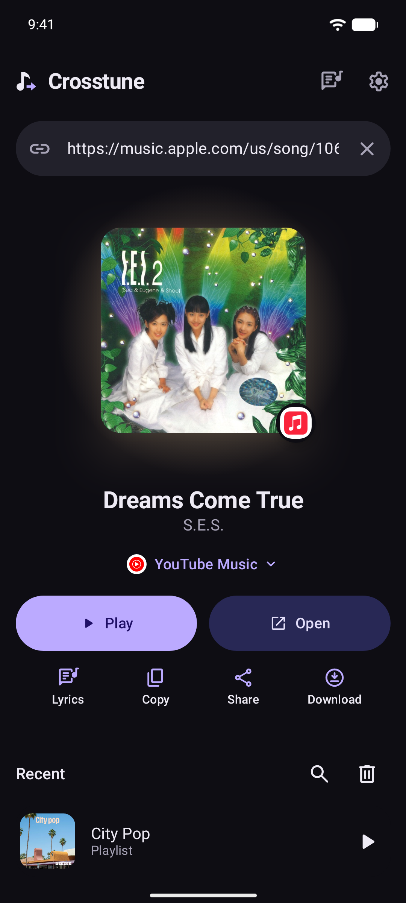
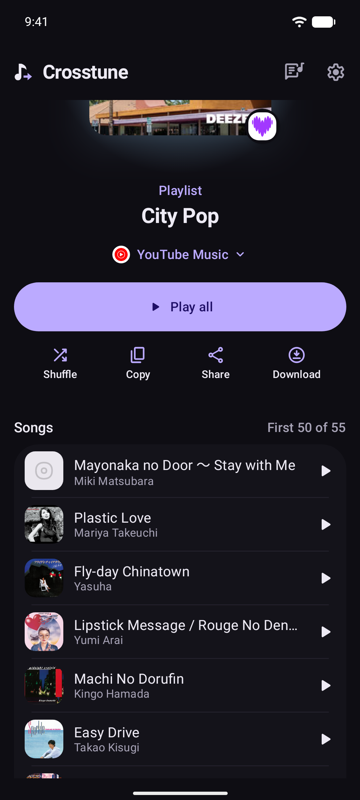
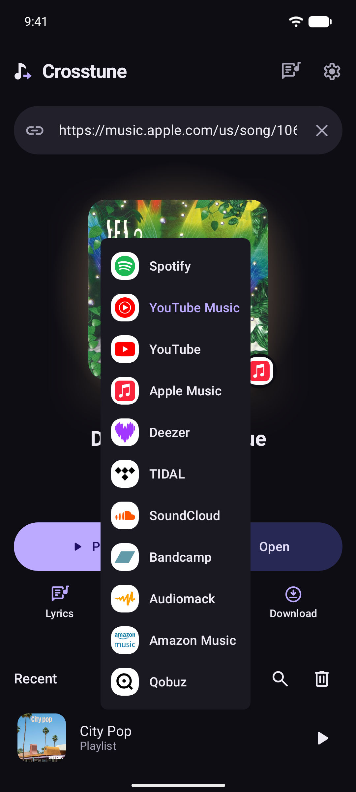

# Crosstune

Open a link from any service in the app you listen on, name the song playing nearby, and follow its lyrics and chords. Learn the words, and practice them with the music.

<p align="center">
  
  
  
</p>

## ⬇️ Install

Needs Android 8.0 or newer.

- [Google Play](https://play.google.com/store/apps/details?id=com.astrovm.crosstune).
- Or the APK from [Releases](https://github.com/astrovm/crosstune/releases). Add `https://github.com/astrovm/crosstune` to [Obtainium](https://github.com/ImranR98/Obtainium) for updates.

## 🚀 Set up

Pasting or sharing a link to Crosstune works with no setup. Under the link field, Crosstune lists what Android has to allow:

1. **Allow links in Crosstune**, so music links you tap in any app open here.
2. **Let lyrics follow your music**, so the words of what's playing show in time.
3. Tap one to open Android's settings, with a small guide to each step. With [Shizuku](https://shizuku.rikka.app) or root on Android 12 or newer, **Fix all** does it in one tap.

Links from Spotify, YouTube Music, Apple Music, Deezer and TIDAL open here from the start. Turn on YouTube in **Settings** → **Open links from**. SoundCloud, Bandcamp, Audiomack, Invidious and Piped links open here when shared or pasted.

The first app you pick on a song is where songs play from then on. Change it in **Settings**. Anything left to allow later shows as **Things to fix** on the main screen.

## Features

- **Tap and go.** A link from one service opens in another, at the exact song, album or artist when the app supports it: Spotify to YouTube Music, Apple Music to Deezer, TIDAL to Apple Music.
- **Choose where.** Pick your music app once, or one per service. Patched builds of YouTube and YouTube Music, as ReVanced, RVX, Morphe and others, count as apps of their own. Or add any site with a search URL like `https://example.com/search?q={query}`.
- **Not in the app you picked?** Crosstune says so, then opens the song where it's from or searches anyway. Choose in **Settings** → **When a song isn't found**.
- **Playlists and albums.** See their songs and open any one, or play them all, in order or shuffled, in YouTube Music, YouTube, TIDAL or Spotify. Spotify pauses between songs while the phone is locked. On a phone with no screen lock, **Wake for Spotify's next song** in **Settings** → **Advanced** keeps it going.
- **Recent.** Search your recent songs, and swipe one away to remove it.
- **Play and stay.** **Play** a song in your music app and control it from Crosstune's own player: pause, skip, seek, shuffle, repeat, like, what's up next and a sleep timer. What's playing waits in a bar on the home screen. Swipe up for the player, up again for the words. When a song is marked as instrumental, the player previews its lyrics after Crosstune hears singing while the lyrics are open.
- **Name that song.** Crosstune listens for up to 12 seconds and shows the song Shazam finds. It also does this by itself when your music app's search can't find what a player says it plays, or the player gives only a title, like a browser tab's. Or type a song's name.
- **Names what the radio plays.** When an app shows only a station's name, a file's or a video's, Crosstune names the song by ear while it's open with that app's bar showing, once you allowed the microphone. For Radio Garden, it checks the station's text with Apple Music and keeps a confirmed title through gaps in that text. If the text stays the same and the microphone is allowed, Crosstune listens to check the title after the song's length plus 10 seconds from when it first saw the text. A matching listen puts the next check one track length later. Without fresh evidence, the title expires after twice the song's length, even while the bar is hidden. When the length is unknown, Crosstune uses 90 seconds as the track length. It checks at 90 seconds and expires the title after 180 seconds without fresh evidence. It hears the phone's own sound, more cleanly with Shizuku or root, and uses the microphone only when the phone won't share its sound, on any speaker, car or headphones. Tap the bar to open the song while it's still playing. A song heard only through the microphone isn't opened, as it may be another one in the room, as through headphones. Simple Radio's stations show, and are named by ear, even when it doesn't report playback state.
- **Lyrics in time.** The words follow your music app, even one on your computer through KDE Connect, or Crosstune listens along. On Radio Garden, Crosstune listens for the position in the song and follows the next song the station names and Apple Music confirms. Each line lights a moment before it's sung. Set how early in **Settings** → **Lyrics**. Tap a line to jump there, resize the words, and fix the timing by tapping the line you hear.
- **Chords.** Chord sheets over the words, with the capo, lined up letter by letter.
- **Offline.** **Download** on a song, album or playlist keeps its lyrics, translation, chords and cover, on Wi-Fi. It also likes each song in Spotify, YouTube Music or TIDAL, so that app can download it too. **Download in your music app too** turns that off.
- **Timing that fits the recording.** Lyrics listen briefly to line up with a live take, a video or another release. On phones with 3 GB of memory or more, they hear the singing and move each line to where it's sung, and time lyrics that came with no timing. This runs on your phone with [whisper.cpp](https://github.com/ggml-org/whisper.cpp), whose 32 MB model downloads once, on Wi-Fi.
- **Report a problem.** Wrong words or timing? One tap in the lyrics sends it to the developer. Say yes once, and Crosstune reports songs with missing lyrics, timing or chords by itself. It listens for singing first, so an instrumental isn't reported, and lyrics found for what looks like an instrumental show once someone sings. Turn it off in **Settings**.
- **Floating lyrics.** Float them over any app.
- **MilkDrop visuals.** 150 [projectM](https://github.com/projectM-visualizer/projectm) visuals behind the lyrics, moving to what your phone plays. Pick which show in **Settings** → **Visuals**.
- **Learn the words.** Kana, pinyin, romaji and any other script in Latin letters under each line, translations, and the meaning of any word. A reading looks wrong? Flag it on the word.
- **Practice with the music.** Save lines and they come back as cards: rate each **Again**, **Hard**, **Good** or **Easy**. A card plays its line in the music app that has the song open, or in a small YouTube player, and you stay in Crosstune. Tap the bell for a daily reminder of the cards due.
- **ChatGPT, if you have it.** Sign in to translate whole songs, explain a line or a song, find the words worth learning, and find songs by describing them.
- **On your TV.** Runs on Android TV and Google TV too: what's playing, its lyrics and visuals on the big screen, all with the remote. **Play** opens a song in YouTube with its lyrics over it.
- **Your colors.** Light or dark, your wallpaper's colors, and pure black for OLED screens.
- **Shortcuts.** One-tap paste, home screen widgets, Quick Settings tiles and a long-press shortcut on the app icon.
- **No tracking.** Drops tracking bits like `?si=` from links.
- **16 languages.** Follows your phone, or pick one in Settings.
- **On your computer.** The [browser extension](extension), for Chrome, Edge, Brave and Firefox, opens music links in the service you pick, and shows the lyrics of what's playing on a music site in its side panel.

## Supported links

| Service | Reads | Exact match |
| --- | --- | --- |
| Spotify | Songs, albums, artists, playlists, `spotify.link`, `spotify:` URIs, track IDs | Songs |
| YouTube Music | Songs, videos and playlists | Songs, albums, artists |
| YouTube | Videos, Shorts, live streams, playlists, `youtu.be` | Songs |
| Apple Music | Songs, albums, artists, playlists | Songs, albums, artists |
| Deezer | Songs, albums, artists, playlists, `link.deezer.com` | Songs, albums, artists |
| TIDAL | Songs, albums, artists, playlists | Songs, albums, artists |
| SoundCloud | Tracks, artists, sets, `on.soundcloud.com` | Songs, albums, verified artists |
| Bandcamp | Tracks, albums | Songs, albums |
| Audiomack | Songs, albums, playlists | Songs, albums, verified artists |
| Amazon Music | Can't read its links | Search |
| Qobuz | Can't read its links | Songs, albums |

Songs shared from Pixel **Now Playing**, **Shazam** links and songs shared from Google's search work too. "Search" means Crosstune opens a search for the title and artist. Bandcamp's app can only search, so there it opens a search for the song, with no **Play**.

## 🛠️ Troubleshooting

**Links still open in another app.**
Turn the service on in **Settings** → **Open links from**. Then in Android, go to **Settings** → **Apps** → **Crosstune** → **Open by default** → **Add link** and turn on its links.

**I got a search, not the song.**
Crosstune found no confident match. Choose what happens then in **Settings** → **When a song isn't found**.

**An older Japanese line still shows its old reading.**
Open the song to refresh its readings. Lines you edited by hand are left alone.

**Practice reminders arrive late.**
In **Settings** → **Practice**, use **Allow exact time**. Without it, Android can hold a reminder.

## Privacy

- No account, analytics or ads. Your history stays on your phone.
- Naming a song sends Shazam a fingerprint of the sound, never the audio. Lining lyrics up with the singing happens on your phone.
- A song's title and artist go to the music services that find and open it, and to lyrics, chords and translation sites. For Radio Garden, Crosstune splits the station's now-playing text into a title and an artist and sends those parts to Apple Music. The text usually describes a song. The station can supply other text in those fields.
- Signed in with ChatGPT, the AI features send OpenAI the song, its lyrics and what you ask.
- The [browser extension](extension) sends the developer nothing. It sends a link's title and artist where the app does, and, while its lyrics panel is open, to LRCLIB, YouTube Music, NetEase Cloud Music, Letras and Genius for the words.
- Crosstune's only server gets the problem reports you send, or turn on. It keeps no IP address, and deletes each report after 180 days.

The full [privacy policy](https://crosstune.cc/privacy/) names every service and what each report carries.

<details>
<summary><b>Verify your download</b></summary>

Release APKs are signed with this certificate. Its SHA-256 fingerprint is also listed on each release:

```text
64:EC:D5:52:E3:4B:B4:15:8A:04:6B:DE:1B:BD:BC:C9:04:23:9D:59:33:CF:74:C4:62:B6:FD:02:A7:B0:F6:FA
```

</details>

## Building

Crosstune builds with the Android SDK and JDK 17 or newer, from a clone with its submodules.
The commands are in [AGENTS.md](AGENTS.md#commands), and how to build, test and release it is in [CONTRIBUTING.md](CONTRIBUTING.md).

Crosstune is licensed under the [GNU General Public License v3.0 only](LICENSE) (GPL-3.0-only).

Crosstune includes, or downloads when it's needed, these works by others. The app lists them in its language, with each license's full text as published, in **Settings** → **About** → **Licenses**, from [`notices.txt`](app/src/main/resources/com/astrovm/crosstune/notices/notices.txt). Rebuild the app from the cloned source to replace projectM with a changed copy.

| Work | By | License |
| --- | --- | --- |
| [JMdict](https://www.edrdg.org/dokuwiki/doku.php?id=wiki_index.php_jmdict-edict_dictionary_project) | Electronic Dictionary Research and Development Group | CC BY-SA 4.0 |
| [Kuromoji](https://github.com/atilika/kuromoji) | Atilika Inc. and contributors | Apache License 2.0 |
| [IPADIC](https://github.com/atilika/kuromoji) | Nara Institute of Science and Technology (NAIST), with entries from ICOT Free Software | NAIST and ICOT licence |
| [UniDic](https://repo1.maven.org/maven2/com/atilika/kuromoji/kuromoji-unidic/0.9.0/) | The UniDic Consortium | BSD 3-Clause License |
| [projectM](https://github.com/projectM-visualizer/projectm) | The projectM Team | GNU LGPL 2.1 or later |
| [MilkDrop's FFT](https://github.com/projectM-visualizer/projectm/blob/v4.1.8/src/libprojectM/Audio/MilkdropFFT.cpp) | Nullsoft, Inc. | BSD 3-Clause License |
| [projectM's expression parser](https://github.com/projectM-visualizer/projectm-eval) | The projectM Team | MIT License |
| [HLSLParser](https://github.com/projectM-visualizer/projectm/tree/v4.1.8/vendor/hlslparser) | Unknown Worlds Entertainment, Inc. | MIT License |
| [OpenGL Mathematics (GLM)](https://github.com/g-truc/glm) | G-Truc Creation | MIT License |
| [SOIL2](https://github.com/SpartanJ/SOIL2) | Martín Lucas Golini and Jonathan Dummer | Public domain, and MIT License |
| [stb_image and stb_image_write](https://github.com/nothings/stb) | Sean Barrett and contributors | Public domain |
| [Independent JPEG Group's JPEG software](https://www.ijg.org/) | Thomas G. Lane and the Independent JPEG Group | IJG License |
| [ETC1 texture code](https://android.googlesource.com/platform/frameworks/native/+/refs/heads/main/opengl/libs/ETC1/etc1.cpp) | Google Inc. | Apache License 2.0 |
| [PowerVR SDK texture decompressor](https://github.com/powervr-graphics/Native_SDK) | Imagination Technologies Ltd. | MIT License |
| [SDL](https://github.com/libsdl-org/SDL) | Sam Lantinga | zlib License |
| [MilkDrop presets](https://github.com/projectM-visualizer/presets-cream-of-the-crop) | Their authors, named in each preset's name | None stated |
| [MilkDrop textures](https://github.com/projectM-visualizer/presets-milkdrop-texture-pack) | Their authors, from MilkDrop and its presets | None stated |
| [whisper.cpp and ggml](https://github.com/ggml-org/whisper.cpp) | The ggml authors | MIT License |
| [YaRN](https://github.com/jquesnelle/yarn) | Jeffrey Quesnelle and Bowen Peng | MIT License |
| [Arm Optimized Routines](https://github.com/ARM-software/optimized-routines) | Arm Limited | MIT License |
| [Whisper](https://github.com/openai/whisper) | OpenAI | MIT License |
| [LLVM libc++, libc++abi, libunwind, compiler-rt and clang's headers](https://github.com/llvm/llvm-project) | The LLVM Project | Apache License 2.0 with LLVM Exceptions |
| [Android's C library headers](https://android.googlesource.com/platform/bionic) | The Android Open Source Project and others | BSD and Apache License 2.0 |
| [Material Symbols and Material Icons](https://github.com/google/material-design-icons) | Google | Apache License 2.0 |
| [Simple Icons](https://github.com/simple-icons/simple-icons) | Simple Icons contributors | CC0 1.0 |
| [Roboto](https://github.com/googlefonts/roboto-classic) | The Roboto Project Authors | SIL Open Font License 1.1 |
| [Shizuku API](https://github.com/RikkaApps/Shizuku-API) | RikkaW | MIT License |
| [OkHttp and Okio](https://github.com/square/okhttp) | Square, Inc. | Apache License 2.0 |
| [Guava](https://github.com/google/guava) | The Guava Authors | Apache License 2.0 |
| [Error Prone and J2ObjC annotations](https://github.com/google/error-prone) | Google | Apache License 2.0 |
| [JSpecify](https://github.com/jspecify/jspecify) | The JSpecify Authors | Apache License 2.0 |
| [AndroidX, Jetpack Compose and Media3](https://android.googlesource.com/platform/frameworks/support) | The Android Open Source Project | Apache License 2.0 |
| [Protocol Buffers](https://github.com/protocolbuffers/protobuf) | Google Inc. | BSD 3-Clause License |
| [Compose Multiplatform](https://github.com/JetBrains/compose-multiplatform) | JetBrains s.r.o. and the Android Open Source Project | Apache License 2.0 |
| [Kotlin and kotlinx.coroutines](https://github.com/JetBrains/kotlin) | JetBrains s.r.o. and Kotlin Programming Language contributors | Apache License 2.0 |
| [Reorderable](https://github.com/Calvin-LL/Reorderable) | Calvin Liang | Apache License 2.0 |

The Japanese word readings in [`jmdict-readings.txt`](app/src/main/resources/com/astrovm/crosstune/jmdict-readings.txt) and the words in kana in [`old-kana.txt`](app/src/main/resources/com/astrovm/crosstune/old-kana.txt) are made from [JMdict](https://www.edrdg.org/dokuwiki/doku.php?id=wiki_index.php_jmdict-edict_dictionary_project) by the Electronic Dictionary Research and Development Group, under the [Group's licence](https://www.edrdg.org/edrdg/licence.html), and changed. The readings: only words of two kanji or more that JMdict reads one way only, where Crosstune reads them otherwise. The words in kana: only the common ones with い or う after their first kana, each with how it's looked up, and those with ひ or ふ there, which are no old spelling. Both are under [CC BY-SA 4.0](https://creativecommons.org/licenses/by-sa/4.0/) too.
