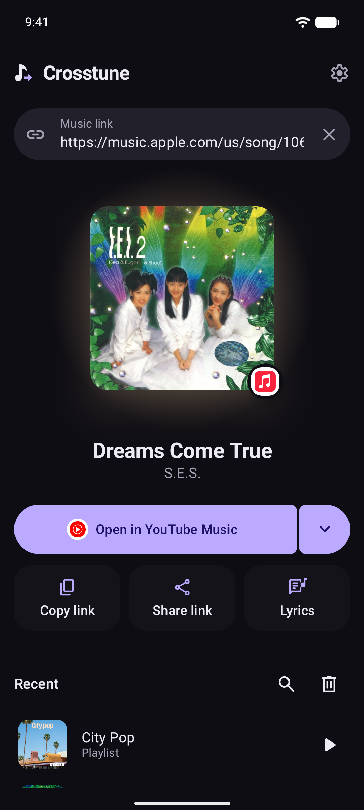
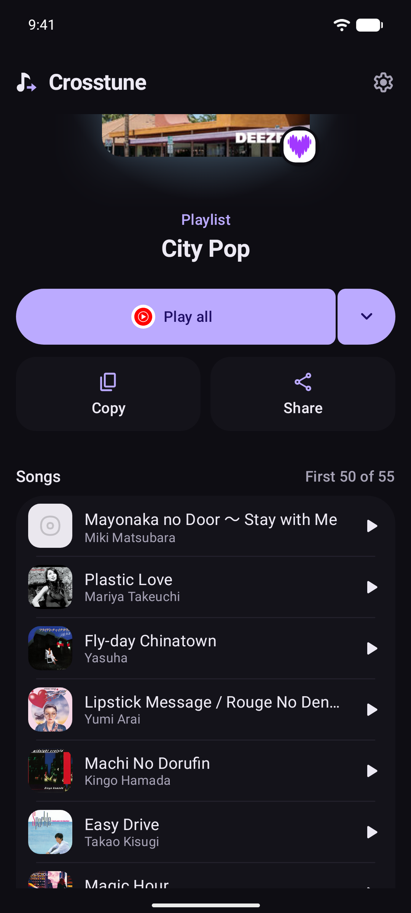
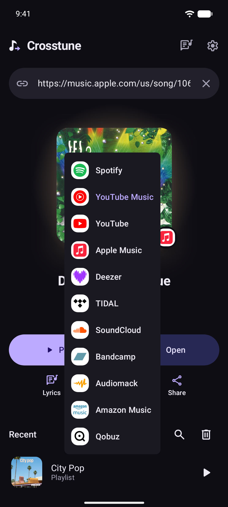

# Crosstune

Open a link from any service in the app you listen on, name the song playing nearby, and follow its lyrics and chords. Learn the words, and practice them with the music.

<p align="center">
  
  
  
</p>

## ⬇️ Install

Needs Android 8.0 or newer.

- Get the APK from [Releases](https://github.com/astrovm/crosstune/releases), or add `https://github.com/astrovm/crosstune` to [Obtainium](https://github.com/ImranR98/Obtainium) for updates.
- Or on Google Play, which is in testing: join the [testers group](https://groups.google.com/g/crosstune-testers), tap **Become a tester** on the [testing page](https://play.google.com/apps/testing/com.astrovm.crosstune), then install from [Google Play](https://play.google.com/store/apps/details?id=com.astrovm.crosstune).

## 🚀 Set up

Pasting or sharing a link to Crosstune works with no setup. To open links you tap in other apps, the app walks you through it:

1. Pick the app you listen in.
2. Tap **Fix** on each thing left in the list. Each one checks itself off when you come back.
3. With [Shizuku](https://shizuku.rikka.app) on Android 12 or newer, tap **Set everything up** instead. It's one tap, and its **Fix** and **Allow** buttons repair things later too.

## Features

- **Tap and go.** A link from one service opens in another, at the exact song, album or artist when the app supports it: Spotify to YouTube Music, Apple Music to Deezer, TIDAL to Spotify.
- **Choose where.** One app per service, ask every time, or add any app or site with a search URL like `https://example.com/search?q={query}`.
- **Not on your app?** Crosstune says so, then opens the song where it's from or searches anyway. Choose in **Settings** → **When a song isn't found**.
- **Playlists and albums.** See their songs and open any one, or play the lot in YouTube Music or YouTube.
- **Recent.** Search your recent songs, and swipe one away to remove it.
- **Play and stay.** **Play** a song in your music app while you stay in Crosstune, with its own player: cover, progress, pause, skip and seek.
- **Name that song.** Crosstune listens for up to 12 seconds and shows the song playing nearby, like a pasted link. Or type a song's name to find it. Prefer Shazam or the Google app? Pick it in **Settings** → **Song recognition app**.
- **Lyrics in time.** The words follow your music app, or Crosstune listens along, song after song. Tap a line to jump there. Also works with YouTube and YouTube Music patched by ReVanced, RVX or Morphe.
- **Chords.** Chord sheets over the words, with the capo, lined up letter by letter.
- **Floating lyrics.** Float them over any app.
- **MilkDrop visuals.** 152 [projectM](https://github.com/projectM-visualizer/projectm) visuals behind the lyrics, moving to what your phone plays. Pick which show in **Settings** → **Visuals**.
- **Learn the words.** Kana, pinyin and romaji under each line, translations, and the meaning of any word.
- **Practice with the music.** Save lines and they come back as cards that play the line in your music app. Rate each one: **Again**, **Hard**, **Good** or **Easy**.
- **ChatGPT, if you have it.** Sign in to translate whole songs, explain a line or a song, find the words worth learning, and find songs by describing them.
- **Your colors.** Light or dark, your wallpaper's colors, and pure black for OLED screens.
- **Shortcuts.** One-tap paste, home screen widgets, Quick Settings tiles and a long-press shortcut on the app icon.
- **No tracking.** Drops tracking bits like `?si=` from links.
- **16 languages.** Follows your phone, or pick one in Settings.

## Supported links

| Service | Reads | Exact match |
| --- | --- | --- |
| Spotify | Songs, albums, artists, playlists, `spotify.link`, `spotify:` URIs, track IDs | Search |
| YouTube Music | Songs, videos and playlists | Songs, albums, artists |
| YouTube | Videos, Shorts, live streams, playlists, `youtu.be` | Songs |
| Apple Music | Songs, albums, artists, playlists | Songs, albums, artists |
| Deezer | Songs, albums, artists, playlists, `link.deezer.com` | Songs, albums, artists |
| TIDAL | Songs, albums, artists, playlists | Songs, albums, artists |
| SoundCloud | Tracks, artists, sets, `on.soundcloud.com` | Songs, albums, verified artists |
| Bandcamp | Tracks, albums | Songs, albums |
| Audiomack | Songs, albums, playlists | Songs, albums, verified artists |
| Amazon Music | Can't read its links | Search |
| Qobuz | Can't read its links | Songs, albums |

Songs shared from Pixel **Now Playing**, **Shazam** links and songs shared from Google's search work too. "Search" means Crosstune opens a search for the title and artist.

## 🛠️ Troubleshooting

**Links still open in another app.**
Turn the service on in **Settings** → **Open links from**. Then in Android, go to **Settings** → **Apps** → **Crosstune** → **Open by default** → **Add link** and turn on its links.

**I got a search, not the song.**
Crosstune found no confident match. Choose what happens then in **Settings** → **When a song isn't found**.

## Privacy

- No account, analytics or ads. History stays on your device.
- A link's service is asked only for its title, artist and cover. With exact match on, the title and artist also go to the search of the app it opens in.
- Lyrics, chords and translations are looked up by title and artist on [LRCLIB](https://lrclib.net), YouTube Music, NetEase Cloud Music, [Letras](https://www.letras.com), [Ultimate Guitar](https://www.ultimate-guitar.com), [LaCuerda](https://acordes.lacuerda.net), [U-FRET](https://www.ufret.jp), [Google Translate](https://translate.google.com), [MyMemory](https://mymemory.translated.net) and [Wiktionary](https://en.wiktionary.org).
- Signed in with ChatGPT, the AI features send OpenAI the song, its lyrics and what you ask. Your sign-in stays on your phone.
- Naming a song uses the microphone only while listening, and only a fingerprint goes to Shazam, never the audio. The visuals use it to move to your music, and record and send nothing.
- Shizuku is used only to change Android's link and lyrics settings for Crosstune.

Full [privacy policy](https://crosstune.4st.li/privacy/).

<details>
<summary><b>Verify your download</b></summary>

Release APKs are signed with this certificate. Its SHA-256 fingerprint is also listed on each release:

```text
64:EC:D5:52:E3:4B:B4:15:8A:04:6B:DE:1B:BD:BC:C9:04:23:9D:59:33:CF:74:C4:62:B6:FD:02:A7:B0:F6:FA
```

</details>

## Building

Clone with `git clone --recurse-submodules`, and use the Android SDK and JDK 17 or newer.

```bash
./gradlew :app:assembleDev   # "Crosstune Dev", installs next to the released app
./gradlew :app:ci            # the checks CI runs
```

More in [CONTRIBUTING.md](CONTRIBUTING.md).

Crosstune is licensed under the [GNU General Public License v3.0 only](LICENSE) (GPL-3.0-only).
